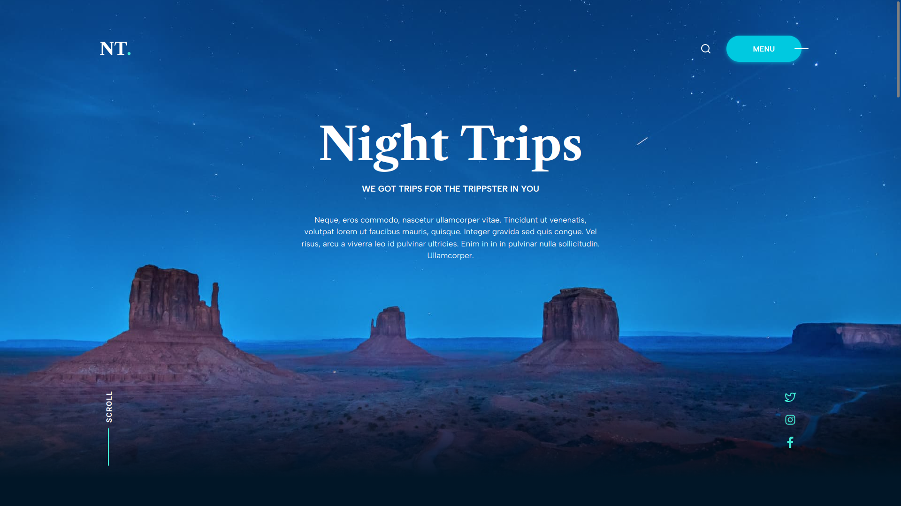

# Night Trips

A travel-themed landing page showcasing unique destinations and adventure experiences.

**[Live Demo](https://web-design-1-night-trips-teq.vercel.app/)** · [Figma Design](https://www.figma.com/design/qinMy6AE08VosT4d52uHxH/Landing-page---%D0%9F%D1%83%D1%82%D0%B5%D1%88%D0%B5%D1%81%D1%82%D0%B2%D0%B8%D1%8F?m=auto&t=EsUWgZ0VyR7MuTEh-6)

## Preview




## Getting Started

Clone the repository and install dependencies:

```bash
git clone https://github.com/TohidEq/web-design-1
cd web-design-1
npm install
```

Run the development server:

```bash
npm run dev
```

Open [http://localhost:3000](http://localhost:3000) in your browser.

## Built With

- Next.js
- React
- TypeScript
- Tailwind CSS
